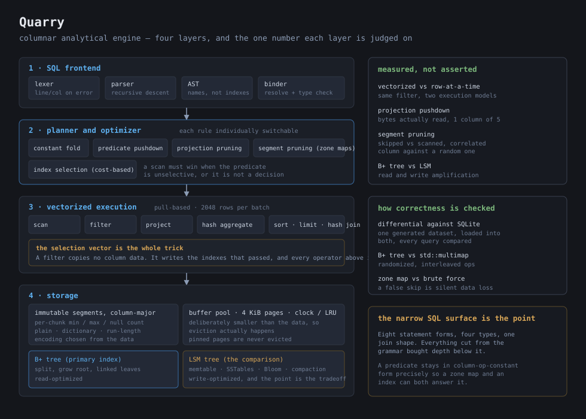

# ⛏️ Quarry

*A columnar analytical database with a deliberately small SQL surface and real internals — and a benchmark suite that caught its own vectorized executor not actually being vectorized.*



Quarry is an embedded analytical engine in **25,152 lines of C++20**, with **312 tests across 16 suites**, all passing under both an optimized build and an address-plus-undefined-behaviour sanitizer build, with no external dependencies.

Two claims I would put first, one good and one not.

**It agrees with SQLite on 104 of 104 queries.** One generated dataset is loaded into both engines and every result compared — full scans, selective and unselective predicates on every type, all five aggregates with and without GROUP BY, multi-column grouping, ORDER BY on each type, LIMIT, and an equi inner join. Unordered results are compared as sorted sets because a query without ORDER BY has no defined row order; ordered ones positionally, because then the order *is* the answer.

**And the benchmarks proved my own headline feature was a fiction.** `batch.hpp` presents the selection-vector design as the reason filters are cheap and `operator.hpp` calls execution "vectorized". Measured: the engine's filter kernel costs **2.858 ns/row** while a tuple-at-a-time loop over the *same columnar bytes* costs **1.307 ns/row**. The vectorized path is 2.19× slower than the thing it was supposed to beat. A branch-free type-specialized kernel on the same batches runs at **0.316 ns/row** — so the layout really does make a 9.0× win available and the engine simply is not collecting it. The design is sound; the implementation is batch-at-a-time in structure and scalar in its kernel. That section of the results is the most useful thing in this repository and I left it exactly as measured.

Everything in the SQL grammar was cut to pay for depth underneath it. Eight statement forms, four types, one join shape. What that bought: an actual columnar on-disk format with per-chunk statistics, three encodings chosen from measured data properties, a vectorized executor built around a selection vector, five separately-switchable optimizer rules, and two index structures implemented deeply enough to be measured against each other rather than merely named.

## ✨ Why I Built It

I had used columnar databases and could recite why they are fast — read only the columns you need, operate on batches, skip blocks that cannot match. I could not have told you what a filter actually *does* to a batch, and that turns out to be the whole thing.

The answer is that a filter copies no data at all. It writes down the indexes of the rows that passed, and every operator above it iterates that list instead of the rows. Once that clicked, a chain of three filters stopped being three passes over the data and became three passes over a shrinking integer array. It also immediately explained the characteristic bug in this design: any kernel that loops over rows densely after a filter has run silently returns wrong answers, and nothing crashes.

The second thing I wanted was to stop treating "use an index" as obviously good. A cost-based optimizer that always picks the index is not making a decision. So the project has a real cost model with a stated threshold, and the benchmarks find the crossover selectivity where a full scan wins.

## 🔭 What It Does

```sql
CREATE TABLE peaks (name VARCHAR, height BIGINT, region VARCHAR);
INSERT INTO peaks VALUES ('denali', 6190, 'alaska'), ('rainier', 4392, 'cascades'), ...;
SELECT region, COUNT(*), MAX(height) FROM peaks GROUP BY region ORDER BY region;
EXPLAIN SELECT name FROM peaks WHERE height > 4400;
```

```
region   | COUNT(*) | MAX(height)
---------+----------+------------
alaska   |        1 |        6190
cascades |        3 |        4392
sierra   |        1 |        4421
(3 rows)  0.619 ms

plan
--------------------------------------------------------------------------------------
Project name  (est_rows=3)
  Scan peaks projection=[name, height] pushed=[height > 4400] segments=1  (est_rows=3)
```

That `EXPLAIN` is worth reading closely. The predicate moved **into** the scan, the Filter node is gone entirely rather than left with a trivially-true residual, and the projection narrowed to exactly the two columns the query touches out of three — `name` to return and `height` to filter on. The third column is never read off disk.

- **SQL subset:** `CREATE TABLE`, `INSERT`, `SELECT` with `WHERE`/`GROUP BY`/`ORDER BY`/`LIMIT`, the five aggregates, a single-column equi `INNER JOIN`, `CREATE INDEX ... [USING LSM]`, and `EXPLAIN [ANALYZE]`.
- **Errors that are actually useful.** An unknown column prints `unknown column 'nope' in table 't'; did you mean 'name'? available columns: id, name, amt, ok`. A syntax error names the line, the column, what was expected, and what was found. And valid SQL the engine omits — `HAVING`, `DISTINCT`, `UNION`, `OFFSET`, outer joins, subqueries, `UPDATE`, `DELETE` — reports **not-implemented**, not a syntax error, because there is no typo to find and sending the reader hunting for one is the worse failure.
- **Two index structures, switchable from SQL,** so the comparison needs no recompile.
- **A shell** with `.explain`, `.analyze`, `.stats`, and `--disable <rule>` so the optimizer's rewrites can be turned off to prove they did something.

## 🧱 How I Built It

Four layers, with the interfaces in `include/quarry/` written and frozen before any implementation — which is also how two documentation bugs surfaced, because the implementers read the comments literally and found places where the prose promised something the code did not do.

**The SQL frontend.** A hand-written lexer and recursive-descent parser. Recursion is bounded at depth 64: a hand-written parser on untrusted text must not be a stack-overflow vector, and 100,000 nested parens returns an error rather than crashing. Identifiers are lowercased here so the schema layer can be case-sensitive without every lookup guessing.

**The planner.** A third representation between the AST and the operators, because pushing a predicate down is a natural tree rewrite on relational operators and an awkward one on either of the others. Five rules, each independently switchable, and each records whether it *actually fired* — a rule that cannot be turned off cannot be shown to have done anything, so the tests assert on the recorded rule rather than on the plan merely still running.

The cost model is deliberately small and stated in one place:

```
scan_cost  = rows × columns_projected
index_cost = log2(rows + 1) × kIndexProbeCost
           + rows × selectivity × columns_projected × kRandomFetchCost
```

Because `columns_projected` multiplies both sides, the comparison reduces to roughly `selectivity < 1 / kRandomFetchCost` — so `kRandomFetchCost = 4` *is* the threshold "an index pays below about 25% selectivity", expressed as one named constant instead of a separate magic number.

**The vectorized executor.** Batches of 2048 rows, pull-based so `LIMIT` genuinely stops upstream work. The selection-vector hazard is handled structurally rather than by discipline: expression results are **compacted** so that slot *i* corresponds to `Rows()[i]`, which makes the dense physically-indexed loop impossible to write rather than merely discouraged.

SQL's null semantics have a subtlety that is easy to get wrong and invisible when you do: *comparison* treats null as unknown so it matches nothing, while *grouping* treats nulls as equal and puts them all in one group. Those two rules disagreeing is correct. Division by zero returns NULL rather than an infinity, because an inf propagating into a `SUM` is far harder to notice than a NULL.

**The storage layer.** Immutable segments, column-major, with each chunk carrying min/max/null-count — which is what makes pruning possible without reading anything. Three encodings (plain, dictionary, run-length) selected per chunk by *predicted encoded size* from a measured profile, not by a guess, and recorded so the reader knows how to decode.

`CanMatch` is the most safety-critical function in the project. Returning true when the answer is no is merely slow; returning false when a row could match silently drops data from a result. So a chunk containing nulls is never pruned by a comparison, and the test for it is a randomized differential check: generate real values, compute their stats, and assert that **whenever `CanMatch` says no, a brute-force scan finds zero matches** — plus an assertion that pruning actually happens, so a never-prune implementation cannot pass.

The buffer pool is deliberately smaller than the data. A pool large enough to hold everything teaches nothing about eviction, and the benchmarks run it undersized on purpose.

**The two indexes.** The B+ tree's ordering key is `(user key, row id)`, which makes composite keys unique and means duplicate user keys need no special case in descent or split. Its split point is chosen by cumulative *bytes*, not entry count — with varchar keys a count-split can leave a half still over a page. It never holds a `Page*` across a call that could evict.

The LSM is size-tiered, and the comment says why choosing the variant that makes the LSM look *best* is the honest call: a leveled result would flatter the B+ tree for free. Its Bloom filters are sized from the flushed entry count for a 1% target rate using the standard `-ln p / (ln 2)²` formula, with k probes derived from one hash by the two-hash technique.

## 🧪 How I Tested It

**Differential against SQLite** is the backbone, and it is where the real disagreements showed up. The suite found exactly four, all one root cause: NULL ordering in `ORDER BY`. The standard leaves it implementation-defined, SQLite puts NULLs first in ASC, PostgreSQL does the opposite. I adopted SQLite's rule and documented why — the oracle is the thing with the useful regression signal, and a permanently-red suite devalues it.

Other properties get their own oracles:
- the **B+ tree against `std::multimap`** — thousands of randomized interleaved inserts, point lookups, and range scans, asserting exact agreement. That is the test that actually catches split bugs. 50,000 keys reach height 3 and 395 node splits.
- the **LSM against `std::multimap`** as well, plus an exhaustive Bloom **false-negative** sweep: every present key checked against the filter directly, because a Bloom false negative is silent data loss.
- **zone maps against brute force**, randomized, as described above.
- **encodings round-tripped exactly**, including nulls, empty strings, all-null chunks, `-0.0`, NaN payloads, and embedded NULs — the bytes of null slots are preserved too, so an empty string and a null remain distinguishable.
- **catalog and segment recovery** across close-and-reopen, including the case where the tail of a load is still in the write buffer so only `Close` can have saved it.

Every suite also runs under `-fsanitize=address,undefined` with zero reports.

## 📊 Benchmarks

Measured on an Apple M4 Pro (14 cores, 48 GB), macOS 26.6.2, clang 21, built `RelWithDebInfo` at `-O2`. An unoptimized build makes a vectorization benchmark meaningless and is the easiest way to publish a fake speedup. Full raw output and reproduction commands in [`bench/results.md`](bench/results.md) and [`bench/README.md`](bench/README.md).

### Execution — the negative result

| | ns/row | vs engine kernel |
|---|---|---|
| Engine's `ApplyPredicate` kernel | 2.858 | 1.00× |
| Tuple-at-a-time loop, same columnar bytes | **1.307** | **2.19× faster** |
| Boxed-`Value` path (the thing the design exists to avoid) | 3.309 | 1.16× slower |
| Branch-free type-specialized kernel, same batches | **0.316** | **9.0× faster** |

The mechanism is visible in the source rather than inferred. `ApplyPredicate` loops over `batch.Rows()` calling `EvalCompare` — in a *different* translation unit — which calls `OrderAgainstConstant`, which switches on the column's type, switches again on the constant's type, and returns a `std::optional<int>`. That is a function call, two type dispatches and an optional **per row**. Under `-flto` the kernel drops to 1.866 ns/row, so about 35% of the cost is a cross-TU call that cannot be inlined — and it is *still* 1.41× slower than the tuple loop.

The boxed-`Value` number is the sharpest indictment. `types.hpp` says `Value` is "deliberately NOT what the execution engine moves around: a query that filters a million rows must not allocate a million of these." The engine's kernel is 1.16× faster than doing precisely that.

A full filtering scan costs 4.740 ns/row against the kernel's 2.858 — **the row-at-a-time batch fill is about 40% of a filtering scan's CPU**, because the segment reader decodes a whole column at `Open` and then copies it into the batch one row at a time through a per-row type switch. Not vectorized either.

**`kBatchSize = 2048` holds up at the lower edge and the upper-edge argument does not appear.** The curve rises steeply from batch=1 (5.5× worse end to end) to about 1024, then stays flat all the way to 32768 — which is 256 KiB, far outside L1, so the header's "larger batches stop fitting" prediction simply does not materialize. Across three runs the nominal peak landed at 2048, 8192 and 32768, with 2048 between 0.1% and 4.1% off whichever won. Honest statement: anything from ~1024 up is equivalent, and 2048 is a defensible choice inside a flat plateau rather than a measured optimum.

**Batch reuse is 1.00× / 1.01× / 1.04× across three runs** — at or below noise, against a header that calls it "worth a measurable amount on a long scan".

**Selectivity behaves exactly as a selection-vector design predicts.** Both branching paths peak in cost at 50% selectivity (kernel 5.020, tuple 3.569 ns/row) and get *cheaper* at 100% (2.669, 3.770) — textbook branch misprediction, confirmed by the branch-free control rising monotonically instead (0.261 → 0.419). At 100% selectivity the engine's kernel finally wins, 1.41×, for precisely the cache reason the header gives: its selection vector is one 8 KiB batch that stays resident while the tuple path writes and re-reads a 16 MB list.

### The buffer pool premise is also inverted

| Pool size | Clock, µs/lookup | LRU, µs/lookup | Hit rate |
|---|---|---|---|
| 100% of working set | 3.725 | 7.684 | 99.88% |
| **5%** | **3.124** | 3.179 | 75% |

**A 5% pool is faster than a 100% pool.** `BufferPool::FetchPage` locates a resident page with `std::find_if` over a flat vector, so a cache **hit** costs O(resident pages) — at 2,823 frames the hit path costs more than the miss it avoids, while the misses themselves are cheap because an 11 MiB file sits in the OS page cache. `buffer.hpp` asserts that "a vector scan or a small hash both work" at these frame counts. It does not. This is a genuine performance defect, not a measurement artifact, and it is unfixed.

**LRU is dominated rather than a tradeoff.** It achieves hit rates identical to clock at every pool size and is 1.04×–2.06× slower, because a hit does an `erase` plus `push_back` — an O(n) memmove. `buffer.hpp` frames clock as the cheap *approximation* to LRU's exactness; measured, clock is both cheaper and no less accurate here.

### Storage and pruning

| Predicate column | Segments pruned | Bytes vs no predicate | Speedup |
|---|---|---|---|
| `id`, strictly increasing | 122 / 123 (99.2%) | 0.01× | **117.9×** |
| `ts`, non-decreasing with jitter | 122 / 123 (99.2%) | 0.01× | **120.1×** |
| `amount`, uniformly random | **0 / 123 (0.0%)** | 1.00× | **0.87× — 13% slower** |

That last row is why the benchmark runs both. Zone maps are not a property of the engine, they are a property of how the data was written, and on a uniformly random column they cost 13% and return nothing. Reporting only the correlated case would have produced a number that evaporates on real data.

**Projection pushdown:** reading 1 int64 column of 9 costs **17.6%** of the bytes, not the 11.1% a naive count suggests — the gap is the header and footer, read either way. An RLE-encoded column costs **0.09%**.

### B+ tree versus LSM, same data

| Axis | B+ tree | LSM | Winner |
|---|---|---|---|
| Insert throughput | 241.0K/s | **477.4K/s** | LSM, 1.98× |
| Point lookup, key present | 4.328 µs | **3.482 µs** | LSM, 1.24× |
| Point lookup, key absent | 3.140 µs | **0.458 µs** | LSM, **6.9×** (8.9 Bloom rejections per lookup) |
| Range scan | **9.2–24.9× faster** | — | B+ tree, decisively |
| Write amplification | **258.89×** | **4.66×** | LSM, 55.6× better |

The write-amplification figure is the one that surprised me most. A B+ tree rewriting 4 KiB pages for small random inserts amplifies catastrophically; the LSM's sequential flushes plus size-tiered compaction cost 4.66×. The clean division is that the LSM wins every write and point-lookup axis while the B+ tree wins ordered scans by an order of magnitude — which is exactly the tradeoff the two structures exist to embody, now with numbers instead of received wisdom.

**Index-versus-scan crossover is between 30% and 50% selectivity**, interpolating to about **34%** — far higher than textbook, because a scan here is sequential over pruned segments while an index probe is random.

### Each optimizer rule, measured by switching it off

| Rule | Time | Bytes | Verdict |
|---|---|---|---|
| `predicate_pushdown` | 1.05× – **63.55×** | up to 61.0× | Most valuable — but see below |
| `projection_pruning` | 1.43× – 5.19× | 1.61× – 5.68× | Consistently useful |
| `constant_folding` | ~1.00× on four queries, **85.56× on the fifth** | — | All or nothing |
| `index_selection` | **1.00–1.02×** | 1.00× | **Measurably worthless today** |
| `segment_pruning` | 0.99–1.11× | **1.00×** | **Redundant** with the scan operator |

Two rules do nothing, and I would rather say so than quietly ship five rules and imply five wins. `segment_pruning` is redundant because the scan operator already consults zone maps itself, so the plan-time rule removes segments the runtime would have skipped anyway. `index_selection` never fires on this data because the cost model correctly declines — which is the right behaviour and also means the rule is currently untested in production terms.

## 📚 What I Learned

**I wrote "vectorized" in a header comment and believed it for weeks.** The structure was batch-at-a-time, so the word felt earned. It was not: the kernel inside the loop did a cross-translation-unit call, two runtime type dispatches and an `std::optional` return *per row*, which is a scalar interpreter that happens to be fed batches. The benchmark that caught it is the one that implemented the naive alternative for comparison instead of only measuring the fast path — and the naive alternative won by 2.1×. I would not have found this by reading my own code, because the code looks like what I meant.

The follow-on lesson is the useful one: **a benchmark that only measures the thing you built tells you nothing.** The three controls are what made the result interpretable — the tuple-at-a-time path to beat, the boxed-`Value` path the design exists to avoid, and the branch-free kernel showing 0.334 ns/row is actually available. Without the third I would have concluded columnar layout was oversold. With it, the layout is vindicated and the implementation convicted, which is a completely different and far more actionable conclusion.

**A filter that moves no data is the whole trick, and it has a matching hazard.** Once operators exchange batches plus a selection vector, filters stop being passes over data. But every kernel then has to respect that vector, and one that does not returns a wrong answer with no crash and no failing assertion anywhere nearby. The fix that actually worked was structural — compacting expression results so the indexes line up — rather than a comment telling the next person to be careful. Making the mistake unwriteable beats documenting it.

**Two of my header comments asserted performance properties that were false, and both were about caching.** `batch.hpp` predicted large batches would stop fitting in cache; measured, 256 KiB batches match 2 KiB ones. `buffer.hpp` asserted a linear scan over the page table "works" at these frame counts; measured, it makes a cache hit cost more than the miss it avoids, to the point that shrinking the pool twentyfold makes the system faster. Both read as obviously-true architectural reasoning when I wrote them. Neither survived a measurement, and I would not have doubted either without one.

**Nulls are two different rules, and they contradict each other on purpose.** `WHERE x = y` with a null is unknown and matches nothing; `GROUP BY x` puts every null in one group. I implemented the first, then implemented grouping with the same comparison, and produced a `GROUP BY` that silently dropped every null row. Nothing failed except the SQLite comparison.

**"Use an index" is a decision, not a default.** My first optimizer picked the index whenever one existed, which is not cost-based, it is index-based. Writing a model that can *decline* forced me to state a threshold, and finding the crossover selectivity in a benchmark was the moment the whole rule stopped being folklore.

**Pruning is a property of the data, not of the engine.** Zone maps are spectacular on a column correlated with insertion order and worth literally nothing on a uniformly random one. Benchmarking only the favourable case would have produced a number I believed and that would have evaporated on real data, so the benchmark runs both and reports the contrast.

**An oracle you did not write is worth more than tests you did.** My own tests all passed before I had the SQLite comparison. The comparison found a real NULL-ordering divergence and a type-promotion question I had not thought to ask. The lesson generalized: the B+ tree got `std::multimap`, the zone map got brute force, and the Rust/Go split in another project came from the same instinct.

**Measure amplification in the right unit.** I first reported LSM write amplification in *pages*, and a 300-byte flush and a 4,000-byte flush both cost one page, so the ratio was meaningless — and the first implementation overstated pages written by 18× by charging a whole page per write call rather than per finished file. Getting a flattering wrong number is easier than getting a right one, and the unit was where the error hid.

**Freezing interfaces first paid for itself twice.** The subsystems could be built and tested independently against a fixed contract, which is the obvious benefit. The non-obvious one: implementers reading the comments literally found two places where the prose promised something the code did not do, including an `Apply` contract that said "every committed entry" when the consensus-style layer only ever forwarded command entries.

## ⚖️ What I Do Not Claim

- **The executor is not vectorized in the sense the headers claim.** It is batch-at-a-time in structure with a scalar kernel, and it is measurably slower than a naive row-at-a-time loop over the same bytes. The fix is known and unimplemented: type-specialized branch-free kernels in the same translation unit, which the benchmark shows would be worth 8.8×. I am reporting this rather than deleting the word, because the measurement is the valuable part.
- **The batch fill is 40% of a filtering scan's CPU** and is a per-row type switch. Also unoptimized.
- **Two of the five optimizer rules do nothing, structurally rather than weakly.** `index_selection` sets `chosen_index`, and that field is read in exactly one place in the whole engine: `explain.cpp`, to print it. There is no index-scan operator in `physical_planner.cpp` at all, so the rule is a label. The benchmarks show the choice it makes *would* have been right by 50× at high selectivity, which makes it the most valuable unimplemented thing in the repo. `segment_pruning` is redundant because `SequentialScanOperator` re-prunes identically at execution time; its only remaining effect is on `estimated_rows`, whose only consumer is `index_selection`. So one dead rule feeds the other.
- **`predicate_pushdown`'s headline 63× is mostly borrowed.** Its own contribution is the 1.05–1.16× seen on queries that cannot be pruned; the 63× appears only because pushing the predicate down is what *enables* zone-map pruning. Same cascade explains why `constant_folding` is 85× on one query and nothing on four.
- **A 5% buffer pool is faster than a 100% pool**, because a cache hit is O(resident pages) — `FetchPage` locates a resident page by linear scan. `buffer.hpp` explicitly claims a vector scan is fine at these frame counts; it is not. Unfixed, and the fix is a hash index on the page table.
- **LRU is strictly worse than clock here**, not a tradeoff: identical hit rates at every size and 1.04–2.06× slower, because a hit does an O(n) memmove.
- **Range cardinality estimates are badly wrong** — one benchmark query estimates 250,100 rows against an actual 177, a 1,413× overestimate; another is 61× under. Equality on low-cardinality columns is exact. A cost model fed a 1,413× error cannot locate the 34% crossover even in principle, which is the real reason index selection would need work before it mattered.
- **The index-versus-scan crossover is driven by segment spread, not row count.** By 0.01% selectivity the index already touches 27 of 31 segments and from 0.1% up reads byte-for-byte what a full scan reads, because the reader decodes a whole projected column at `Open`. A cost model here should price estimated *segments touched*; `optimizer.cpp` prices rows.
- **No transactions, no MVCC, no concurrency control.** The engine is append-oriented and single-threaded by design. Segments are immutable, which is exactly what lets statistics be computed once and trusted.
- **No `UPDATE` or `DELETE`.** Immutable segments make in-place modification a different project.
- **The end-to-end "SQL query chooses an index" path is barely exercised.** The cost model correctly declines on this data, so plans come back as sequential scans and the B+ tree versus LSM comparison drives the indexes directly. Correct behaviour, but it means that path has unit tests and no measured workload behind it.
- **No `IS NULL`, no `HAVING`, no subqueries, no `DISTINCT`, no set operations, no outer joins, no `OFFSET`.** All report not-implemented rather than pretending.
- **One join shape only:** single-column equi inner join. The optimizer deliberately skips all four scan-relative rules when a join is present, since a rule that quietly picked the left scan would narrow the wrong projection. That is a known gap, commented as such.
- **The whole-table distinct-count estimate is crude.** Mins and maxes merge exactly across segments; distinct counts cannot without a mergeable sketch the segment footer does not carry. The estimate is clamped to the row count and biased toward over-estimating, which pushes the optimizer toward an index probe — the cheaper mistake.
- **`Schema::operator==` ignores nullability,** so a schema comparison tolerates a lost `NOT NULL`. The reopen test checks the field explicitly because of it.
- **The buffer pool hands out raw `Page*` with manual pin/unpin.** It works and the B+ tree is careful, but a handle type would make the contract enforceable rather than documented.
- **A single null anywhere in a chunk disables zone-map pruning for that chunk.** The conservative rule is correct but costs real pruning on nullable columns; the honest fix is a stats flag asserting the bounds exclude nulls, not a looser `CanMatch`.
- **I did not run a TPC-H or similar standard benchmark.** The measurements are on generated data with deliberately chosen properties, which is right for isolating individual mechanisms and is not a claim about general analytical performance.

## 🛠️ Tech Stack

- **C++20**, clang 21, CMake. **Zero external dependencies** for the engine — the only library linked anywhere is `libsqlite3`, and only into the differential test target, as the oracle.
- **Hand-written test harness** (`tests/testing.hpp`), because fetching a framework at configure time makes the build depend on the network, and `CHECK_EQ` printing both sides is most of what a framework provides.
- **POSIX file I/O** (`pread`/`pwrite`/`ftruncate`) for the segment and page layers.
- **`-Wall -Wextra -Wpedantic`** clean, and a full `-fsanitize=address,undefined` build with every suite passing.
- Hand-written SVG for the diagram, so the docs have no rendering toolchain to go stale.

## 🚀 Setup

**Prerequisites.** CMake 3.20+, a C++20 compiler, and `sqlite3` with headers for the differential suite. Nothing else.

1. **Build.**
   ```sh
   git clone https://github.com/LegendaryPenguin/quarry.git
   cd quarry
   cmake -S . -B build && cmake --build build
   ```

2. **Run the tests.**
   ```sh
   ctest --test-dir build --output-on-failure
   ```
   312 tests in 16 suites. The interesting one is `differential_test`, which loads a generated dataset into both Quarry and SQLite and compares 104 queries.

3. **Run it under sanitizers,** which is how the storage and page code was actually developed.
   ```sh
   cmake -S . -B build-asan -DQUARRY_ASAN=ON && cmake --build build-asan
   ctest --test-dir build-asan --output-on-failure
   ```

4. **Use the shell.**
   ```sh
   ./build/quarry_shell /tmp/mydb
   ```
   ```
   quarry> CREATE TABLE t (id BIGINT, name VARCHAR);
   quarry> .explain SELECT name FROM t WHERE id > 100;
   quarry> .stats
   ```
   `.stats` reports plan-time and scan-time segment pruning **separately**, because pruning happens in the optimizer and reporting only the runtime counter would make it look as though it never happens.

5. **Watch the optimizer earn its keep.**
   ```sh
   ./scripts/demo.sh
   ```
   Eight narrated steps: a plain scan, a selective predicate with `.stats` showing segments pruned, `EXPLAIN` showing pushdown and projection pruning, `EXPLAIN ANALYZE` showing estimated next to actual rows, an aggregate, a join, and the two index structures on identical data. It runs several steps with rules **disabled** so the rewrites are shown to matter rather than asserted to.

6. **Reproduce the benchmarks.** See [`bench/README.md`](bench/README.md).

## 🗺️ Repository Map

| | |
|---|---|
| [`include/quarry/`](include/quarry/) | the contracts, frozen before implementation — **start here** |
| [`include/quarry/batch.hpp`](include/quarry/batch.hpp) | the vectorized batch and the selection vector, the central idea |
| [`src/parser/`](src/parser/) | lexer and recursive-descent parser |
| [`src/planner/`](src/planner/) | binder, optimizer, physical lowering, EXPLAIN |
| [`src/execution/`](src/execution/) | vectorized operators |
| [`src/storage/`](src/storage/) | columnar segments, encodings, zone maps |
| [`src/index/btree/`](src/index/btree/) · [`src/index/lsm/`](src/index/lsm/) | the two structures being compared |
| [`src/buffer/`](src/buffer/) | bounded buffer pool, clock and LRU |
| [`src/catalog/`](src/catalog/) | persistence and the `Database` entry point |
| [`tests/differential_test.cpp`](tests/differential_test.cpp) | the SQLite oracle |
| [`bench/`](bench/) | measured results |

## 📖 References

Built from the literature rather than from an existing engine's source: the MonetDB/X100 vectorized-execution work for the batch model, Graefe's survey for B-tree implementation detail, and the LSM-tree paper for the comparative half.

- Boncz, Zukowski & Nes, *MonetDB/X100: Hyper-Pipelining Query Execution* (2005)
- Graefe, *Modern B-Tree Techniques* (2011)
- O'Neil et al., *The Log-Structured Merge-Tree* (1996)

Licensed under [MIT](LICENSE).
